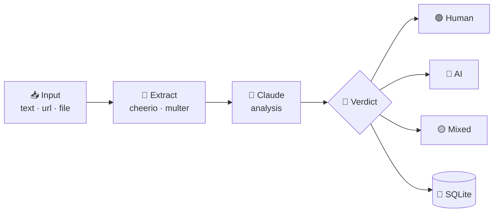

<div align="center">


<br/>

**Detect whether text was written by a human or an AI.**
Plain text · URLs · file uploads — scored by Claude, saved to SQLite.

<br/>


<br/>

[Quick Start](#-quick-start) · [Docker](#-docker-production) · [API](#-api-reference) · [Database](#-database-schema) · [Security](#-security-notes)

</div>

<br/>


<div align="center">

</div>



1. **Input** — paste text, give a URL, or upload `.txt` / `.md` / `.html`.
2. **Extract** — Cheerio scrapes pages, Multer handles uploads, text is trimmed to 8000 chars.
3. **Analyze** — Claude scores perplexity, burstiness, phrasing and vocabulary.
4. **Verdict** — `AI`, `Human` or `Mixed`, with probability, confidence, flagged phrases, saved to history.

<br/>


<div align="center">

</div>

```
DETECTOR-AI/
├── backend/
│   ├── server.js          # Express entry point
│   ├── db.js              # SQLite database (better-sqlite3)
│   ├── routes/
│   │   ├── detect.js      # POST /api/detect/text|url|file
│   │   └── history.js     # GET/DELETE /api/history
│   ├── .env.example       # Copy to .env and fill in
│   ├── Dockerfile
│   └── package.json
│
├── frontend/
│   ├── src/
│   │   ├── App.jsx
│   │   ├── main.jsx
│   │   ├── index.css
│   │   ├── utils/api.js          # Axios API helpers
│   │   ├── components/
│   │   │   ├── Navbar.jsx
│   │   │   ├── Results.jsx       # Detection results display
│   │   │   └── UI.jsx            # Shared components
│   │   └── pages/
│   │       ├── Detect.jsx        # Main detection page
│   │       ├── History.jsx       # Scan history
│   │       ├── ScanDetail.jsx    # Single scan detail
│   │       └── Stats.jsx         # Statistics dashboard
│   ├── vite.config.js
│   ├── Dockerfile
│   ├── nginx.conf
│   └── package.json
│
├── docker-compose.yml
└── README.md
```

<br/>


<div align="center">

</div>

### 1 · Clone and install

```bash
git clone https://github.com/RICK2814/DETECTOR-AI.git
cd DETECTOR-AI

# Backend
cd backend
npm install

# Frontend
cd ../frontend
npm install
```

### 2 · Configure backend

```bash
cd backend
cp .env.example .env
```

Edit `.env`:

```env
PORT=4000
ANTHROPIC_API_KEY=sk-ant-your-key-here   # Get from console.anthropic.com
FRONTEND_URL=http://localhost:5173
```

### 3 · Start backend

```bash
cd backend
npm run dev      # uses nodemon for auto-reload
# or
npm start
```

> 🟢 Backend online at **http://localhost:4000**

### 4 · Start frontend

```bash
cd frontend
npm run dev
```

> 🟢 Frontend online at **http://localhost:5173**

<br/>


<div align="center">

</div>

```bash
# At project root
cp backend/.env.example backend/.env
# Edit backend/.env with your ANTHROPIC_API_KEY

docker-compose up --build
```

| Service | URL |
|---|---|
| 🖥️ Frontend | http://localhost:5173 |
| ⚙️ Backend API | http://localhost:4000 |

<br/>


<div align="center">

</div>

<details open>
<summary><b>🔍 Detect</b></summary>

<br/>

**Text**
```http
POST /api/detect/text
Content-Type: application/json

{ "text": "Your text here..." }
```

**URL**
```http
POST /api/detect/url
Content-Type: application/json

{ "url": "https://example.com/article" }
```

**File**
```http
POST /api/detect/file
Content-Type: multipart/form-data

file: <file upload>   (.txt, .md, .html)
```

</details>

<details>
<summary><b>🕘 History and stats</b></summary>

<br/>

| Method | Endpoint | Description |
|---|---|---|
| `GET` | `/api/history?page=1&limit=20` | Paginated scan history |
| `GET` | `/api/history/:id` | Single scan |
| `DELETE` | `/api/history/:id` | Delete scan |
| `GET` | `/api/history/stats` | Dashboard stats |
| `GET` | `/api/health` | Health check |

</details>

<br/>


<div align="center">

</div>

SQLite database is stored at `backend/data/detector.db`.

**`scans`** table — stores every detection result:

| Column | Type | Description |
|---|---|---|
| `id` | TEXT (UUID) | Primary key |
| `created_at` | DATETIME | Timestamp |
| `source_type` | TEXT | `text`, `url`, or `file` |
| `source_ref` | TEXT | URL or filename |
| `input_text` | TEXT | First 500 chars of input |
| `word_count` | INTEGER | Total words |
| `verdict` | TEXT | `AI`, `Human`, or `Mixed` |
| `ai_prob` | REAL | 0–100 probability |
| `confidence` | TEXT | Low / Medium / High / Very High |
| `summary` | TEXT | Analysis summary |
| `signals` | TEXT | JSON: perplexity / burstiness / etc |
| `ai_flags` | TEXT | JSON array |
| `human_flags` | TEXT | JSON array |
| `phrases` | TEXT | JSON array of flagged phrases |
| `ip_address` | TEXT | Client IP |

**`stats`** table — running totals for the dashboard.

<br/>


<div align="center">

</div>

| Layer | Tech |
|---|---|
| 🎨 Frontend | React 18, Vite, React Router |
| ⚙️ Backend | Node.js, Express 4 |
| 🗄️ Database | SQLite via better-sqlite3 |
| 🧠 AI | Anthropic Claude (claude-sonnet-4) |
| 🕸️ Web scraping | Axios + Cheerio |
| 📤 File uploads | Multer |
| 🛡️ Security | Helmet, express-rate-limit, CORS |
| 🚢 Deployment | Docker + Nginx |

<br/>


<div align="center">

</div>

- 🚦 **Rate limiting:** 30 requests/minute per IP on `/api/detect`
- 📦 **File uploads** capped at 5 MB
- ✂️ **Input text** truncated to 8000 characters before sending to Claude
- 🌐 **CORS** restricted to `FRONTEND_URL`
- 🪖 **Helmet** sets secure HTTP headers

<br/>


<div align="center">

</div>

Released under the **MIT** license.

<br/>


