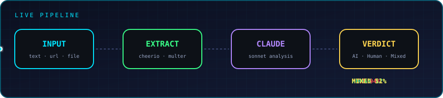
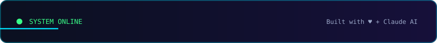

<div align="center">



**Detect whether text was written by a human or an AI.**

Analyze pasted text, public URLs, and supported text files with Claude-powered analysis, then review saved scan results in a SQLite-backed history.

[](https://react.dev/)


[Features](#-features) · [Quick Start](#-quick-start) · [Docker](#-docker) · [API Reference](#-api-reference) · [Security](#-security-notes)

</div>

---

## ✨ Features

- **Multiple input types:** analyze pasted text, a web page URL, or an uploaded `.txt`, `.md`, or `.html` file.
- **AI-assisted analysis:** uses Anthropic Claude to assess writing signals such as phrasing, vocabulary, perplexity, and burstiness.
- **Readable results:** returns a verdict (`AI`, `Human`, or `Mixed`), an estimated AI probability, confidence, a summary, and flagged phrases/signals where provided by the analyzer.
- **Scan history:** view previous scans, open an individual result, and delete a scan.
- **Statistics dashboard:** review aggregate scan statistics.
- **Local persistence:** stores scan records in SQLite.
- **Production-minded defaults:** Express security headers, request rate limiting, upload limits, CORS configuration, and Docker/Nginx files.

> **Important:** AI-text detection is probabilistic, not proof of authorship. Human writing can be flagged as AI-generated and AI-assisted writing can be classified as human. Do not use a detector result as the sole basis for academic, hiring, disciplinary, or other high-impact decisions.

## ⚙️ How It Works



1. **Provide input** — paste text, enter a URL, or upload a supported file.
2. **Extract content** — the backend fetches/parses URL content or processes the uploaded file.
3. **Analyze** — extracted text is sent to Claude for signal-based analysis. The documented input is truncated to 8,000 characters before analysis.
4. **Review the result** — see the verdict and associated analysis details; scan results are saved for later review.

## 🧱 Project Structure


```text
DETECTOR-AI/
├── backend/
│   ├── server.js
│   ├── db.js
│   ├── routes/
│   │   ├── detect.js
│   │   └── history.js
│   ├── .env.example
│   ├── Dockerfile
│   └── package.json
├── frontend/
│   ├── src/
│   │   ├── App.jsx
│   │   ├── main.jsx
│   │   ├── index.css
│   │   ├── utils/api.js
│   │   ├── components/
│   │   │   ├── Navbar.jsx
│   │   │   ├── Results.jsx
│   │   │   └── UI.jsx
│   │   └── pages/
│   │       ├── Detect.jsx
│   │       ├── History.jsx
│   │       ├── ScanDetail.jsx
│   │       └── Stats.jsx
│   ├── vite.config.js
│   ├── Dockerfile
│   ├── nginx.conf
│   └── package.json
├── docker-compose.yml
└── README.md
```

## 🚀 Quick Start


### Prerequisites

- Node.js and npm
- An Anthropic API key
- Git

### 1. Clone the repository

```bash
git clone https://github.com/RICK2814/DETECTOR-AI.git
cd DETECTOR-AI
```

### 2. Install dependencies

Open a terminal at the repository root:

```bash
cd backend
npm install

cd ../frontend
npm install
```

### 3. Configure the backend

Create a local environment file:

```bash
cd ../backend
cp .env.example .env
```

Set the values in `backend/.env` (keep your actual API key private):

```env
PORT=4000
ANTHROPIC_API_KEY=your_anthropic_api_key
FRONTEND_URL=http://localhost:5173
```

Get an API key from the [Anthropic Console](https://console.anthropic.com/). Confirm any additional environment variables required by `backend/.env.example`. Never commit `.env` or expose API keys in frontend code.

### 4. Run the backend

```bash
cd backend
npm run dev
```

For a non-watch run, use `npm start` if configured in `backend/package.json`.

Backend URL: **http://localhost:4000**

### 5. Run the frontend

In a second terminal:

```bash
cd DETECTOR-AI/frontend
npm run dev
```

Frontend URL: **http://localhost:5173**

If your frontend directory is already the current working directory, simply run `npm run dev`.

## 🐳 Docker


From the repository root:

```bash
cp backend/.env.example backend/.env
```

Add your Anthropic API key to `backend/.env`, then build and start the services:

```bash
docker-compose up --build
```

| Service | Local URL |
|---|---|
| Frontend | http://localhost:5173 |
| Backend API | http://localhost:4000 |

To stop the services, press `Ctrl+C`; to stop detached containers, run `docker-compose down`.

## 🔌 API Reference


The routes below are exposed by the backend. Run the application locally before sending requests.

### Detection

#### Analyze text

```http
POST /api/detect/text
Content-Type: application/json

{
  "text": "Paste the text you want to analyze."
}
```

#### Analyze a URL

```http
POST /api/detect/url
Content-Type: application/json

{
  "url": "https://example.com/article"
}
```

Only submit URLs you are authorized to access. URL fetching should be restricted and validated in production to reduce server-side request forgery (SSRF) risk.

#### Analyze a file

```http
POST /api/detect/file
Content-Type: multipart/form-data

file: <.txt, .md, or .html file>
```

### History, statistics, and health

| Method | Endpoint | Purpose |
|---|---|---|
| `GET` | `/api/history?page=1&limit=20` | Get paginated scan history |
| `GET` | `/api/history/:id` | Get one saved scan |
| `DELETE` | `/api/history/:id` | Delete one saved scan |
| `GET` | `/api/history/stats` | Get dashboard statistics |
| `GET` | `/api/health` | Check backend health |

The exact response fields and error formats are defined by the backend route handlers.

## 🗄️ Database


The SQLite database is stored at `backend/data/detector.db`.

The `scans` records include the following fields:

| Field | Meaning |
|---|---|
| `id` | Scan UUID |
| `created_at` | Scan timestamp |
| `source_type` | Input type: `text`, `url`, or `file` |
| `source_ref` | Source URL or filename, where applicable |
| `input_text` | Stored excerpt of the submitted text (first 500 characters) |
| `word_count` | Word count |
| `verdict` | `AI`, `Human`, or `Mixed` |
| `ai_prob` | Estimated AI probability from 0–100 |
| `confidence` | Analysis confidence label |
| `summary` | Analysis summary |
| `signals` | JSON-encoded analysis signals |
| `ai_flags` / `human_flags` | JSON-encoded signal lists |
| `phrases` | JSON-encoded flagged phrases |
| `ip_address` | Client IP field |

A `stats` table is also used for dashboard totals.

## 🧰 Tech Stack


| Layer | Technologies |
|---|---|
| Frontend | React 18, Vite, React Router |
| Backend | Node.js, Express 4 |
| Database | SQLite with `better-sqlite3` |
| AI analysis | Anthropic Claude |
| URL parsing | Axios and Cheerio |
| File uploads | Multer |
| Security | Helmet, `express-rate-limit`, CORS |
| Deployment | Docker and Nginx |

## 🔐 Security Notes


The repository documents these default safeguards:

- **Rate limiting:** 30 requests per minute per IP on detection endpoints.
- **Upload limit:** files are capped at 5 MB.
- **Input length:** text is truncated to 8,000 characters before analysis.
- **CORS:** configured through `FRONTEND_URL`.
- **HTTP headers:** Helmet is used to set security-related headers.

Before deploying publicly, review the implementation and hosting environment for API authentication, URL allow-listing/SSRF protection, request-size limits, secret handling, data retention, and SQLite persistence. Do not assume the listed controls alone make an internet-facing deployment secure.

## 📜 License


This project is released under the **MIT License**. See the repository's license file for the full terms.

---

<div align="center">


**Built for exploring AI-assisted text analysis.**
</div>
